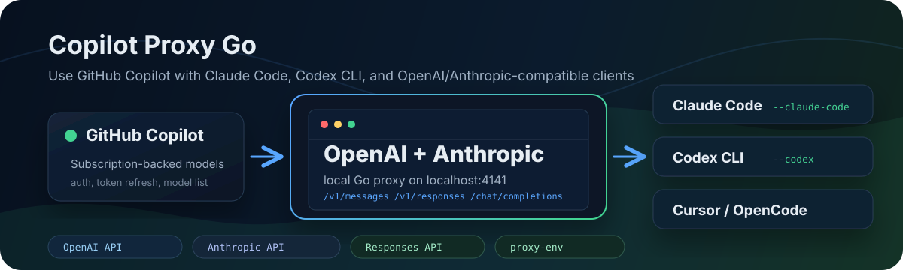
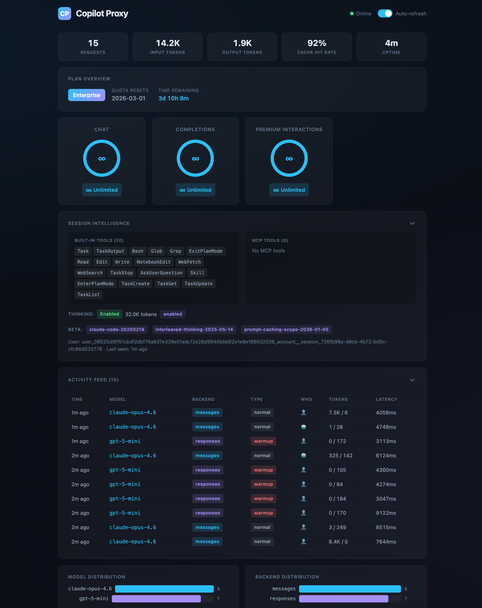

<div align="center">
  
[](https://ko-fi.com/R6R01Z1AEV)

</div>

# Copilot Proxy Go

[](https://github.com/tonghaoch/copilot-proxy-go/actions/workflows/go.yml)

Use **GitHub Copilot** with **Claude Code**, **Codex CLI**, Cursor, OpenCode, and any OpenAI/Anthropic-compatible client.

copilot-proxy-go is a local Go proxy that turns your GitHub Copilot subscription into OpenAI-compatible and Anthropic-compatible API endpoints, with first-class setup for Claude Code and Codex CLI.

## Works Great With

| Tool | One-command setup | API |
|------|-------------------|-----|
| Claude Code | `./copilot-proxy-go start --claude-code` | Anthropic Messages API |
| Codex CLI | `./copilot-proxy-go start --codex` | OpenAI Responses API |

## Highlights

- **Claude Code ready** — interactive model selection and environment generation with `--claude-code`
- **Codex CLI ready** — generates a Responses API configuration with `--codex`
- **VPN/proxy friendly** — use `start --proxy-env` to route upstream requests through `HTTP_PROXY` / `HTTPS_PROXY` (or their lowercase equivalents)
- **OpenAI + Anthropic compatible** — supports Chat Completions, Responses, Messages, and Embeddings
- **Copilot-backed** — uses your GitHub Copilot account as the backend model provider
- **Optional direct Anthropic API** — prefer your own Anthropic API key for supported Claude models
- **Token management** — GitHub OAuth device-code flow with automatic Copilot token refresh

## Quick Start

### 1. Build

Requires **Go 1.25 or later** and a GitHub account with access to Copilot.

```bash
go build -o copilot-proxy-go .
```

### 2. Authenticate

```bash
./copilot-proxy-go auth
```

The command prints a verification URL and a one-time code. Open the URL in your browser and enter the code to authorize access. It reuses a saved GitHub token if one exists; use `auth --force` to authenticate again. Run `./copilot-proxy-go debug` to see the token and configuration paths for your platform.

This step is optional: `start` also authenticates when no saved token is available. If your network requires a proxy, follow [Behind a VPN or proxy](#behind-a-vpn-or-proxy) instead.

### 3. Start for your client

Claude Code:

```bash
./copilot-proxy-go start --claude-code
```

Codex CLI:

```bash
./copilot-proxy-go start --codex
```

Generic OpenAI/Anthropic-compatible server:

```bash
./copilot-proxy-go start
```

The proxy binds to `127.0.0.1:4141` by default. OpenAI-compatible clients should use `http://127.0.0.1:4141/v1` as the base URL; Anthropic-compatible clients should use `http://127.0.0.1:4141`.

The setup flags print a client launch command and try to copy it to your clipboard. Keep the proxy running, then run that command in another terminal. They do not launch or install the client, and `--claude-code` and `--codex` cannot be used together.

### Behind a VPN or proxy

If an upstream provider requires a proxy in your network, export your proxy variables and start with `--proxy-env`:

```bash
export https_proxy=http://127.0.0.1:7890
export http_proxy=http://127.0.0.1:7890
export NO_PROXY=localhost,127.0.0.1,::1
export no_proxy="$NO_PROXY"

./copilot-proxy-go start --proxy-env
```

Only `start` supports `--proxy-env`; without it, upstream requests ignore proxy environment variables. `ALL_PROXY` / `all_proxy` is not supported. If authentication requires a proxy, skip the separate `auth` step: `start --proxy-env` also runs the device-code flow when no saved token exists. You can combine it with `--claude-code` or `--codex`.

## Features

- **Multi-API support** — Chat Completions, Messages (Anthropic), Responses, Embeddings
- **Automatic translation** — routes Anthropic requests to the best available backend (native Messages API → Responses API → Chat Completions)
- **Thinking/reasoning support** — translates thinking/reasoning blocks where supported; behavior and signature compatibility depend on the model and backend
- **Streaming** — SSE streaming with proper event translation across all API formats
- **Quota optimization** — routes detected Claude Code compact/warmup requests on `/v1/messages` to the configured `smallModel` (default: `gpt-5-mini`); `compactUseSmallModel` controls compact routing
- **Local dashboard** — view usage, request metrics, session state, and quota information in your browser

## Dashboard

Open `http://127.0.0.1:4141/dashboard` while the proxy is running. Local request metrics are kept in memory and reset on restart; Copilot quota is fetched from upstream.
Total input includes uncached input, cache reads, and cache writes. The cache-write TTL breakdown includes only writes whose TTL was reported by the provider.



## Usage with Claude Code

```bash
./copilot-proxy-go start --claude-code
```

This interactively selects primary, small/fast, Opus, and Fable models, saves the small model to the proxy configuration, and generates a command to run in another terminal. Use the model picker or `/models` to find models available to your account. Claude model versions are exposed in Claude Code's dashed form; models reporting a context window of at least 1,000,000 tokens also get a `[1m]` hint. This hint reflects the reported capability, not a context-window upgrade.

Or set the variables manually (Bash/Zsh):

```bash
export ANTHROPIC_BASE_URL=http://127.0.0.1:4141
export ANTHROPIC_AUTH_TOKEN=copilot-proxy
export ANTHROPIC_MODEL='<primary-model-id>'  # Choose from /models or use --claude-code.
export ANTHROPIC_SMALL_FAST_MODEL=gpt-5-mini
export ANTHROPIC_DEFAULT_SONNET_MODEL="$ANTHROPIC_MODEL"
export ANTHROPIC_DEFAULT_HAIKU_MODEL="$ANTHROPIC_SMALL_FAST_MODEL"
export DISABLE_NON_ESSENTIAL_MODEL_CALLS=1
export CLAUDE_CODE_DISABLE_NONESSENTIAL_TRAFFIC=1
export NO_PROXY=localhost,127.0.0.1,::1
export no_proxy="$NO_PROXY"
claude
```

If Copilot rejects Claude Code's server-side `safeguards` field, the proxy retries that Claude Code request without the rejected field and its paired beta header. It does not fabricate safety verdicts: Claude Code falls back to its own classifier requests, which can incur token usage. Set `CLAUDE_CODE_AUTO_MODE_SERVER=0` when launching Claude Code to use that fallback without first attempting server-side checks. With Claude Code 2.1.302 or later, set `CLAUDE_CODE_AUTO_MODE_MODEL` to an available model ID, such as a Haiku model, to choose the client-side approval classifier separately from the main conversation. A smaller classifier can make different safety decisions; server-side classifiers ignore this setting.

## Usage with Codex CLI

```bash
./copilot-proxy-go start --codex
```

This interactively selects a chat model and generates a Codex command, including the selected context window when reported by Copilot. Models without a native Responses endpoint are translated through the Messages or Chat Completions backend. Or set it manually (Bash/Zsh; replace the example model with one available to your account):

```bash
export CODEX_API_KEY=copilot-proxy
export NO_PROXY=localhost,127.0.0.1,::1
export no_proxy=localhost,127.0.0.1,::1
codex \
  -c 'model="gpt-5.3-codex"' \
  -c 'model_provider="copilot-proxy"' \
  -c 'model_providers.copilot-proxy.name="Copilot Proxy"' \
  -c 'model_providers.copilot-proxy.base_url="http://127.0.0.1:4141/v1"' \
  -c 'model_providers.copilot-proxy.env_key="CODEX_API_KEY"' \
  -c 'model_providers.copilot-proxy.wire_api="responses"'
```

## Configuration and API Keys

Configuration is stored in `config.json` in the application data directory, alongside `github_token`:

- **macOS:** `~/Library/Application Support/copilot-proxy-go/`
- **Linux:** `$XDG_DATA_HOME/copilot-proxy-go/`, or `~/.local/share/copilot-proxy-go/` when unset
- **Windows:** `%LOCALAPPDATA%\copilot-proxy-go\`, or `~\AppData\Local\copilot-proxy-go\` when unset

Use `./copilot-proxy-go debug` to see the resolved paths. `smallModel` chooses the compact/warmup routing target; `compactUseSmallModel` enables compact routing and does not affect warmup routing.

For native Messages requests, breakpoints default to one hour when no breakpoint in the request specifies a TTL. Set `cacheTTL` to `"5m"` for five minutes or `""` to leave client breakpoints unchanged; requests containing explicit TTLs are passed through unchanged to preserve their ordering. To override every native Messages breakpoint, including an explicit client TTL, start with `--force-cache-ttl 1h` (or `5m`). Responses requests translated to Messages receive cache breakpoints automatically. Cache eligibility and hits depend on the upstream model, minimum prompt length, and an unchanged prefix; one-hour cache writes may cost more than five-minute writes.

API-key authentication is disabled when `auth.apiKeys` is empty. To enable it, set `auth.apiKeys` to a list of non-empty keys in `config.json`, then restart the proxy. Clients must send a configured key via `x-api-key` or `Authorization: Bearer <key>`. Replace the `copilot-proxy` placeholder in the manual client examples (and in the generated Claude Code command) with your key; Codex setup automatically uses the first configured key.

Configure API keys before exposing the server with `--host 0.0.0.0`, and use TLS via a reverse proxy for access over untrusted networks. Authentication covers the dashboard and utility endpoints too; only `GET /` and `OPTIONS` requests bypass it. Without configured keys, `/token` is additionally restricted to loopback clients.

### Direct Anthropic API

Set `ANTHROPIC_API_KEY` **in the proxy process** to prefer the first-party Anthropic API for models in that key's Anthropic catalog. For a key that can access multiple workspaces, also set `ANTHROPIC_WORKSPACE_ID`; this takes precedence over client workspace headers. For example, in Bash:

```bash
read -r -s -p 'Anthropic API key: ' ANTHROPIC_API_KEY; printf '\n'
export ANTHROPIC_API_KEY
./copilot-proxy-go start --budget-usd 200 --force-cache-ttl 1h
```

The key is not a proxy-client authentication key and is not written to the configuration file. Keep it out of command history and replace it if exposed. GitHub authentication is still needed for the Copilot-backed endpoints.

Supported models use Anthropic directly for `/v1/messages`, `/v1/messages/count_tokens`, and `/responses` translated to Messages; other models, Chat Completions, and Embeddings continue to use Copilot. On these routed endpoints, the response header `X-Copilot-Proxy-Upstream` identifies the selected provider.

By default, when Anthropic rejects a `/v1/messages` or `/v1/messages/count_tokens` request because of exhausted credit, an authentication or permission error, rate limiting, or a server error, the proxy retries it through Copilot. Fallbacks are visible: the response carries `X-Copilot-Proxy-Fallback: anthropic; <reason>`, a warning is logged, the failed Anthropic attempt and the Copilot retry appear as separate dashboard rows, and `/api/stats` reports `fallback_count`. Malformed requests and connection failures are not retried, and `/responses` does not fall back. Start with `--anthropic-fallback=false` to return Anthropic errors to the caller instead.

The dashboard's **Usage by provider** card and the `providers` field of `/api/stats` split requests, errors, and tokens between the Anthropic API and Copilot; with a budget, `budget.provider_spent_usd` splits this process's estimated spend (restored spend is not attributed).

## API Endpoints

| Endpoint | Method | Description |
|----------|--------|-------------|
| `/` | GET | Health check |
| `/v1/messages` | POST | Anthropic Messages API |
| `/v1/messages/count_tokens` | POST | Upstream token count, with an approximate fallback |
| `/chat/completions`, `/v1/chat/completions` | POST | OpenAI Chat Completions |
| `/responses`, `/v1/responses` | POST | OpenAI Responses API |
| `/embeddings`, `/v1/embeddings` | POST | Embeddings |
| `/models`, `/v1/models` | GET | List available models |
| `/token` | GET | Current Copilot bearer token (sensitive) |
| `/usage` | GET | Copilot quota and usage |
| `/api/stats` | GET | In-memory request metrics and latest session snapshot |
| `/dashboard` | GET | Usage dashboard (web UI) |

### Token-spend budget

```bash
./copilot-proxy-go start --budget-usd 200
```

The budget estimates **this process's** token usage from Copilot's per-model prices or the built-in first-party Anthropic rates and reported input, output, cache-read, and cache-write tokens. It uses long-context prices above the model's threshold and conservative cache-write pricing when a write's TTL is unknown. Compaction iterations are priced separately so their usage is not missed or charged at the wrong context tier. If usage is incomplete, or an earlier retry may have reached inference without reporting usage, it reserves a conservative estimate using the model's token limits and highest applicable prices when those bounds are available. Streaming Chat Completions request a final usage report. `/api/stats` and the dashboard distinguish the reported-usage estimate from the reserve for uncertain usage; both count toward the limit. A restored amount is treated as reported usage unless its reserved portion is supplied separately.

This is **not a guaranteed GitHub or Anthropic spending cap or invoice**. Existing usage, plan allowances, discounts, server-tool fees, taxes, and charges outside this process are not included, and retry reserves may exceed actual charges. Anthropic prices are maintained in the proxy and can become stale; the Anthropic Models API does not provide pricing. Requests already admitted can finish and exceed the limit. Missing model pricing rejects that request; direct Anthropic models also require reported input and output limits. Incomplete usage with no reliable bound (including interrupted multi-iteration requests and unknown embeddings batches) pauses further model requests rather than silently undercounting. When budgeting is enabled, server-side model fallbacks and advisor tools are rejected because their additional models cannot yet be priced safely. Health and status endpoints remain available.

Restarting normally resets the estimate. To carry it forward, note `estimated_spent_usd` and `reserved_usd` from `/api/stats` after in-flight requests finish (or from the final budget log after a graceful shutdown), then start with, for example, `--budget-usd 200 --budget-spent-usd 42.50 --budget-reserved-usd 10`. The reserve is part of the restored total, not added to it. Include a conservative reserve for any prior requests whose cost was unknown. The restored values are estimates, not persistent billing reconciliation.

## CLI Reference

### `start` — Run the proxy server

```
copilot-proxy-go start [flags]

Flags:
  -a, --account-type string   individual, business, or enterprise (default "individual")
  -c, --claude-code           interactive model selection for Claude Code
      --codex                 interactive model selection for Codex CLI
      --budget-usd float      estimated per-process token-spend ceiling in USD
      --budget-spent-usd float  restore prior estimated spend (requires --budget-usd)
      --budget-reserved-usd float  reserved portion of restored spend (requires --budget-spent-usd)
      --force-cache-ttl string  override native Messages cache breakpoints: 5m or 1h
      --anthropic-fallback      retry through Copilot when the direct Anthropic API fails (default true)
  -g, --github-token string   GitHub OAuth token (skips device code flow)
      --host string           host/IP to bind to, use 0.0.0.0 for all interfaces (default "127.0.0.1")
  -p, --port int              port to listen on (default 4141)
      --proxy-env             enable HTTP proxy from env vars (HTTP_PROXY/HTTPS_PROXY; lowercase also supported)
      --show-token            print tokens to console
  -v, --verbose               enable verbose/debug logging
```

### `auth` — Authenticate with GitHub

```
copilot-proxy-go auth [flags]

Flags:
      --force        force re-authentication
      --show-token   print token to console
  -v, --verbose      enable verbose/debug logging
```

### `check-usage` — Show Copilot quota and usage

```bash
./copilot-proxy-go check-usage
```

Requires a saved GitHub token. This command does not support `--proxy-env`; if you need a proxy, start the server with `--proxy-env` and use its `/usage` endpoint or dashboard instead.

### `debug` — Show diagnostic information

```bash
./copilot-proxy-go debug
./copilot-proxy-go debug --json
```

Prints version, platform, application paths, and whether token/config files exist, without printing token contents.

## License

MIT
